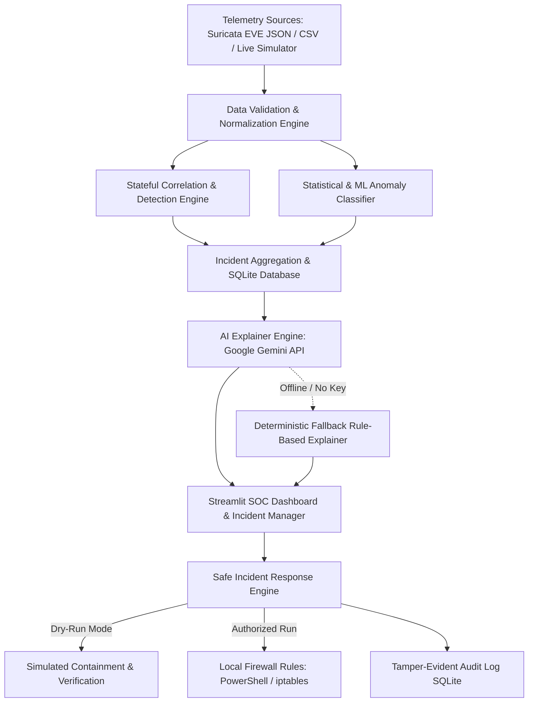

# SentinelAI: Staged Implementation & Upgrade Plan

**Project:** SentinelAI — AI-Powered Network Intrusion Detection & Incident Response Platform  
**Target Environment:** Local Windows 10/11 (PowerShell & VS Code) + Streamlit Web Dashboard  
**Architecture Target:** Modular Python Architecture with Stateful Heuristic & Behavioral Detection Engine, Optional Transparent Machine Learning Classifier, Real Google Gemini LLM Copilot with Deterministic Local Fallback, SQLite Persistent Storage, and Safe Auditable Response Playbooks.

---

## 1. Architectural Blueprint & Target Data Flow

---

## 2. Staged Implementation Roadmap

### Stage 1: Repository Audit, Initial Documentation & Baseline Verification *(Current Stage)*
- **Objectives:** Complete forensic inspection of existing code, trace execution, catalog bugs and missing components, and establish project tracking documentation.
- **Deliverables:**
  - `PROJECT_AUDIT.md`: Forensic audit of existing code, functional matrix, and security risks.
  - `IMPLEMENTATION_PLAN.md`: Complete staged roadmap with acceptance criteria and testing protocols.
  - `CHANGELOG.md`: Transparent record of changes across stages.
- **Acceptance Criteria:** Repository thoroughly audited without destructive modifications; clear roadmap established.

---

### Stage 2: Bug Fixes, Project Clean-Up & Environment Setup
- **Objectives:** Resolve naming anomalies, create clean module aliases, set up dependency specifications, and configure environment templates.
- **Tasks:**
  - Fix module typo: Create `response_engine.py` while maintaining a backwards-compatible alias for `response_enigne.py`.
  - Clean up duplicate typo file `requiremnets.txt`.
  - Update `requirements.txt` with required libraries: `streamlit`, `pandas`, `plotly`, `numpy`, `google-genai` / `google-generativeai`, `python-dotenv`, `pydantic`, `pytest`, `scikit-learn`.
  - Create `.env.example` with clear instructions for `GEMINI_API_KEY`.
  - Verify clean import across all modules in Windows PowerShell.
- **Acceptance Criteria:** `python -c "import detector, analyzer, explainerAI, response_engine"` runs without warnings or errors.

---

### Stage 3: Robust Behavioral Detection Engine & Comprehensive Test Suite
- **Objectives:** Replace naive single-row signature lookups with genuine stateful behavioral correlation and transparent heuristic rules.
- **Tasks:**
  - Implement temporal sliding-window analysis to detect:
    1. **Port Scanning:** Single source IP connecting to $> N$ distinct destination ports within time window $T$.
    2. **Brute Force Authentication:** Repeated connection attempts or failed login signatures on administrative ports (22, 3389, 445, 80/443 auth) exceeding frequency thresholds.
    3. **Volumetric DDoS / Flooding:** High packet surges directed at a single target IP/service exceeding statistical baselines.
    4. **Data Exfiltration:** High outbound byte/packet ratios directed towards external or non-standard ports.
    5. **Suspicious Reconnaissance:** Host sweeps and abnormal ping/ICMP discovery patterns.
  - Calculate transparent confidence scores ($0.0 - 1.0$) with explicit evidence strings (e.g., *"Host probed 14 distinct ports in 10 seconds"*).
  - Add optional transparent Machine Learning anomaly scorer (IsolationForest or trained Random Forest classifier) with clear separation from rule-based detection.
  - Implement robust schema validation for incoming event dictionaries and DataFrames; handle missing or malformed fields gracefully.
  - Build automated unit tests in `tests/test_detector.py` covering normal traffic, each attack category, malformed records, and edge cases.
- **Acceptance Criteria:** All detection tests pass via `pytest`; false-positive rate on normal traffic is near zero; evidence strings document exact triggering conditions.

---

### Stage 4: Google Gemini AI Integration with Safe Fallback & Schema Validation
- **Objectives:** Integrate Google Gemini for rich cybersecurity incident analysis, threat explanations, and actionable investigation playbooks, while maintaining 100% functionality offline.
- **Tasks:**
  - Implement official Gemini SDK client in `explainerAI.py`.
  - Load `GEMINI_API_KEY` securely from environment variables using `python-dotenv`.
  - Craft structured system prompts requiring Gemini to output validated JSON containing:
    - Executive summary
    - Technical attack mechanism
    - Business and infrastructure impact assessment
    - MITRE ATT&CK technique mapping
    - Defensive investigation steps
    - Containment recommendations
  - Implement schema validation using `Pydantic` to reject malformed LLM outputs.
  - Build bulletproof local fallback: If `GEMINI_API_KEY` is missing, quota is exceeded, or network is down, seamlessly generate high-quality deterministic rule-based analysis without crashing.
  - Create unit tests in `tests/test_explainer.py` testing both online mock and offline fallback behavior.
- **Acceptance Criteria:** AI briefing and incident explanations work smoothly with or without a valid `GEMINI_API_KEY`.

---

### Stage 5: Incident Persistence, Lifecycle Management & SQLite Database
- **Objectives:** Replace ephemeral memory state with a lightweight, robust SQLite database for events, incidents, AI explanations, and audit logs.
- **Tasks:**
  - Create `database.py` with SQLite schema:
    - `events`: Normalized raw network telemetry.
    - `incidents`: Unique incident ID, timestamp range, category, source/dest IP & ports, severity, confidence, evidence, status (`Open`, `Investigating`, `Mitigated`, `Resolved`, `False Positive`).
    - `ai_analyses`: Incident ID, executive briefing, technical analysis, recommendations, provider (`gemini` or `local_fallback`).
    - `response_actions`: Action ID, incident ID, action type, target IP/port, execution mode (`dry_run` or `live`), result, timestamp, operator.
  - Provide automatic database initialization and safe demo data reset functionality.
  - Create automated tests in `tests/test_database.py`.
- **Acceptance Criteria:** Incidents and responses persist across Streamlit reloads; status updates are reflected immediately.

---

### Stage 6: Structured JSON Event Ingestion & Live-Like Monitoring Simulator
- **Objectives:** Support industry-standard log formats (Suricata EVE JSON, generic security events) and provide a controlled live traffic simulator.
- **Tasks:**
  - Build log parsers for:
    - Suricata EVE JSON logs (flow, alert, dns, http events).
    - Custom security CSV / JSON files.
  - Implement a multi-threaded or timer-based **Live Monitoring Simulator**:
    - Simulates incoming network traffic (normal background web browsing, interspersed with periodic attack scenarios).
    - Clearly labels simulated events (`SIMULATED: Lab Scenario`).
    - Start/Stop controls on the dashboard.
  - Ensure packet processing is thread-safe and non-blocking.
- **Acceptance Criteria:** Users can upload a JSON event log, run detection, or activate live simulation with clear status indicators.

---

### Stage 7: Safe, Auditable Incident Response Workflow
- **Objectives:** Build an analyst-approved, defensive response orchestration engine with dry-run safety and tamper-evident audit logging.
- **Tasks:**
  - Implement formal response lifecycle:
    `Detection → Evidence Validation → Severity Evaluation → Playbook Recommendation → Analyst Approval → Execution (Dry-Run by Default) → Verification → Audit Log`.
  - Support defensive actions:
    - Simulated Firewall Block (Dry-Run with exact PowerShell/iptables command verification).
    - Host Isolation Recommendation.
    - SOC Escalation & Incident Status Transition.
    - Rollback / Unblock Script Generation.
  - Validate all IP addresses strictly using Python's `ipaddress` library to eliminate command injection risks.
  - Record every action in the SQLite audit log with timestamp, operator, parameters, and verification result.
  - Unit tests in `tests/test_response.py`.
- **Acceptance Criteria:** Dry-run execution records an audit log entry; invalid IPs are rejected; zero arbitrary shell execution without explicit confirmation.

---

### Stage 8: Dashboard Polish, Defense Hardening & Error Handling
- **Objectives:** Elevate the Streamlit dashboard to a multi-page/multi-tab professional SOC application with responsive design, error boundaries, and rich visualizations.
- **Tasks:**
  - Structure into intuitive tabs:
    1. **Overview & Executive Telemetry:** DEFCON status, KPI metrics, dynamic traffic timeline, risk breakdown.
    2. **Incident Management & SOC Queue:** Searchable/filterable incident queue, status updates, drill-down modal/expander with evidence and MITRE mappings.
    3. **AI Copilot & Threat Explainer:** Deep-dive Gemini explanations, interactive analyst query box, investigation checklists.
    4. **Response & Audit Log:** Controlled execution panel (Dry-run toggle, approval button, rollback generator), audit table.
    5. **Log Ingestion & Live Monitoring:** File upload (CSV/JSON), parser status, live traffic simulation stream with start/stop.
  - Implement graceful error boundaries: user-friendly alerts instead of raw Python tracebacks.
- **Acceptance Criteria:** Visually stunning, intuitive interface suitable for hackathon presentation with zero runtime crashes on unexpected inputs.

---

### Stage 9: Documentation, Presentation Guide & Hackathon Demo Preparation
- **Objectives:** Complete user documentation, automated test verification, and deliver a rehearsed 5–7 minute demonstration script.
- **Tasks:**
  - Write comprehensive `README.md` with:
    - Architecture diagrams (Mermaid).
    - Step-by-step Windows PowerShell setup (venv, dependencies, `.env`).
    - Running the dashboard (`streamlit run app.py`).
    - Running the automated test suite (`pytest`).
    - Testing each attack category with provided datasets.
  - Create sample test datasets in `data/`:
    - `normal_traffic.csv` / `normal_traffic.json`
    - `attack_port_scan.json`
    - `attack_brute_force.json`
    - `attack_ddos_flood.json`
    - `malformed_records.json`
  - Write a 5–7 minute demo script covering key talking points for judges and faculty.
- **Acceptance Criteria:** A newcomer can clone the repository, run `pytest`, launch `app.py`, and follow the demo script smoothly on Windows.

---

## 3. Dependency Specification Matrix

| Package | Minimum Version | Purpose |
| :--- | :--- | :--- |
| `streamlit` | `>=1.30.0` | Modern responsive SOC dashboard |
| `pandas` | `>=2.0.0` | Tabular telemetry manipulation |
| `plotly` | `>=5.18.0` | Interactive security charts & timelines |
| `numpy` | `>=1.24.0` | Statistical calculations & metrics |
| `google-genai` / `google-generativeai` | `>=0.8.0` | Real Gemini LLM Copilot integration |
| `python-dotenv` | `>=1.0.0` | Safe `.env` configuration |
| `pydantic` | `>=2.5.0` | Strict schema validation for logs & LLM output |
| `pytest` | `>=7.4.0` | Automated unit & integration testing |
| `scikit-learn` | `>=1.3.0` | Optional anomaly detection / classification |

---

## 4. Verification & Testing Protocol

Every stage will be validated against:
1. **Automated Tests:** Running `pytest` across all implemented modules.
2. **Static Code Quality:** No syntax errors, unhandled exceptions, or command injection vulnerabilities.
3. **Headless & UI Verification:** Verifying both headless backend pipelines and local Streamlit dashboard rendering.
