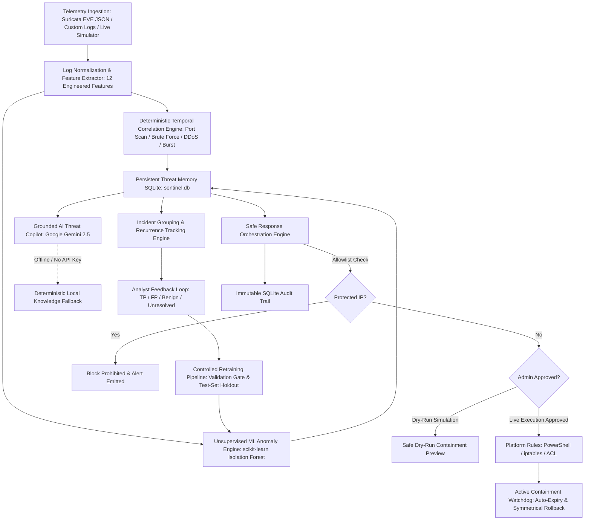

# 🛡️ SentinelAI — Machine Learning Threat Intelligence & Adaptive Response Platform

[](https://www.python.org/)
[](https://streamlit.io/)
[](https://fastapi.tiangolo.com/)
[](https://pytest.org/)
[](https://scikit-learn.org/)
[](https://ai.google.dev/)
[](LICENSE)

SentinelAI is an enterprise-grade, defensive cybersecurity telemetry monitoring, machine learning anomaly detection, threat intelligence memory, and safe incident response orchestration platform. It combines deterministic multi-event temporal correlation rules with unsupervised **scikit-learn Isolation Forest** machine learning anomaly scoring, persistent threat memory in **SQLite**, ground-truth analyst feedback tracking, grounded **Google Gemini** threat investigation, and multi-layered **safe defensive response orchestration** with automated block expiry and rollback.

---

## 🏛️ System Architecture



---

## 🚀 Key Modules & Capabilities

### 1. Machine Learning Detection (`ml_engine.py`)
- **Engineered Telemetry Features (12 Numerical Inputs):**
  - Traffic Volume: `packets`, `flow_frequency`, `mean_packets_per_flow`
  - Port Profile: `port`, `unique_ports_contacted`, `is_privileged_port` (ports 0–1023), `is_admin_port` (ports 22, 3389, 445, 8080)
  - Protocol One-Hot Encoding: `proto_tcp`, `proto_udp`, `proto_icmp`
  - Connection Outcomes: `outcome_allowed`, `outcome_blocked`
- **Zero Data Leakage:** Target indicators, attacker labels, and analyst verdicts are strictly excluded from feature inputs. Imputation cleanly handles missing ports (`0`), protocols (`UNKNOWN`), and packet counts (`1`).
- **Unsupervised Isolation Forest:** Evaluates multi-dimensional feature space density to compute continuous decision function anomaly scores alongside normalized confidence (`0.0 - 1.0`).
- **Strict Non-Proof Disclaimer:** The system explicitly states across all UIs and APIs:
  > *"Notice: Anomaly scores measure statistical deviation from learned traffic baselines and are NOT proof of an attack or malicious compromise."*
- **Clear Separation of Concerns:** Rule-based heuristics (`T1046`, `T1110`, `T1498`), statistical anomaly scores (`Isolation Forest`), and verified attack classifications (`Analyst Verdicts`) remain segregated at all times.
- **Repeatable Controlled Retraining Pipeline:** Generates synthetic laboratory fixtures, enforces rigorous dataset validation gates (minimum 10 samples, variance check), performs holdout test-set evaluation (`accuracy`, `roc_auc`, `pr_auc`), version-stamps models (`isolation_forest_v1.0.X`), and supports one-click version rollback.

### 2. Persistent Threat & Incident Memory (`database.py`)
- **Schema Architecture:**
  - `incidents`: Enriched schema capturing `incident_id`, `timestamp`, `source_ip`, `destination_ip`, `ports`, `protocols`, `model_version`, `ml_anomaly_score`, `ml_is_anomaly`, `recurrence_count`, `analyst_verdict`, `analyst_user`, `analyst_reason`, `response_history`, `raw_evidence`, and `last_seen`.
  - `analyst_feedback`: Segregated ground-truth storage recording incident ID, verdict, reviewer username, audit timestamp, and justification.
  - `model_registry`: Version registry tracking model artifacts, training algorithms, sample counts, validation metrics, and active deployment status.
  - `active_blocks`: Live and simulated containment rule tracking recording rule ID, target IP, execution mode, duration in minutes, creation timestamp, expiry timestamp, admin approver, verification status, and rollback commands.
  - `audit_trail`: Tamper-evident ledger recording all SOC containment actions and status transitions.
- **Multi-Event Incident Grouping:** Correlates multiple raw flow events into unified threat incidents within sliding temporal windows rather than generating fragmented alerts.
- **Repeat Indicator Tracking:** Tracks IP recurrence counts across historical windows without making unfounded assumptions about human identity.
- **Privacy & Security Controls:** Recursively masks sensitive fields (`password`, `token`, `secret`, `api_key`) before storing raw evidence. Automated data retention pruning (`apply_data_retention`) purges stale historical records beyond configurable retention thresholds.

### 3. Analyst Feedback & Controlled Learning
- **Reviewer Classification:** Authorized analysts can review alerts and designate verdicts:
  - `True Positive` (Confirmed attack)
  - `False Positive` (Normal operational traffic misflagged)
  - `Benign` (Authorized administrative scan or test traffic)
  - `Unresolved` (Pending additional forensic triage)
- **Segregated Storage:** Analyst verdicts are recorded independently in `analyst_feedback` and never overwrite unverified model predictions.
- **Controlled Retraining Only:** SentinelAI **never** automatically retrains on individual incoming alerts to prevent model poisoning and baseline drift. Retraining is an explicit administrative action with holdout validation and model reversion capabilities.

### 4. Grounded Gemini Threat Copilot (`explainerAI.py`)
- **Contextually Grounded Reasoning:** Leverages Google Gemini (`gemini-2.5-flash`) grounded strictly in actual stored event evidence, recurrence statistics, and MITRE ATT&CK techniques.
- **Structured Epistemic Separation:**
  - `Observed Facts`: Verifiable telemetry observations (ports contacted, packet volumes, protocol).
  - `Model Predictions`: Isolation Forest anomaly scores and statistical deviation context.
  - `Threat Hypotheses`: Plausible adversary objectives and MITRE ATT&CK mapping.
  - `Forensic Checklist`: Actionable investigation and verification procedures.
- **Strict AI Safety Guardrail:** The AI is strictly advisory. The explainer carries a non-negotiable notice:
  > *"AI Guidance Notice: This assessment is advisory only. Autonomous firewall modification based solely on AI output is strictly prohibited."*
- **Deterministic Offline Fallback:** Functions with 100% reliability even when offline or without a Gemini API key.

### 5. Safe Defensive Response Orchestration (`response_engine.py`)
- **Dry-Run by Default:** All containment actions default to non-intrusive simulation with zero host disruption.
- **Protected Infrastructure Allowlist:** Core infrastructure and loopback addresses (`127.0.0.1`, `::1`, `192.168.1.1`, `10.0.0.1`, `172.16.0.1`, `1.1.1.1`, `8.8.8.8`, `8.8.4.4`, `9.9.9.9`) are permanently protected from automated or accidental blocking.
- **Multi-Stage Approval Gate:** Live firewall modifications require explicit administrator approval (`admin_approved=True`).
- **Configurable Temporary Blocks:** Supports temporary containment durations (15m, 30m, 60m, 120m, 240m) with an automated expiry watchdog (`check_and_expire_blocks`).
- **Permanent Ban Safeguards:** Permanent blocks are segregated into privileged administrative actions requiring explicit confirmation, written justification (minimum 10 characters), and an audit record.
- **Symmetrical Rollbacks:** Automatically generates and executes rollback commands (PowerShell `Remove-NetFirewallRule`, Linux `iptables -D`).
- **Command Injection Prevention:** Strict IP validation using Python's standard `ipaddress` module prevents shell injection vulnerabilities.

---

## 💻 Windows Setup & Installation Guide

### Prerequisites
- Windows 10 or 11 / Linux / macOS
- Python 3.12+ installed (ensure **"Add python.exe to PATH"** was checked during installation)
- Visual Studio Code or PowerShell terminal

### Step 1: Clone Repository
```powershell
git clone https://github.com/JIYA-R5/CYBERplus.git
cd CYBERplus
```

### Step 2: Create & Activate Virtual Environment
```powershell
# Create virtual environment
python -m venv .venv

# Activate virtual environment in PowerShell
.\.venv\Scripts\Activate.ps1
```
*(If you encounter execution policy restrictions in PowerShell, run: `Set-ExecutionPolicy -Scope Process -ExecutionPolicy Bypass`)*

### Step 3: Install Required Dependencies
```powershell
# For local full dashboard (Streamlit + Plotly + Tests):
pip install -r requirements-dev.txt

# Or for lean cloud production (Vercel serverless < 500 MB):
pip install -r requirements.txt
```

### Step 4: Configure Environment Variables
Copy the template configuration file:
```powershell
Copy-Item .env.example .env
```
Open `.env` in VS Code and configure optional parameters:
```ini
# Google Gemini API Key (optional - system falls back to offline deterministic rules if omitted)
GEMINI_API_KEY=your_gemini_api_key_here

# Default Response Mode: dry_run (recommended) or live
RESPONSE_MODE=dry_run

# Detection Rule Thresholds
PORT_SCAN_THRESHOLD=3
BRUTE_FORCE_THRESHOLD=3
BURST_FLOW_THRESHOLD=5
CRITICAL_PACKET_THRESHOLD=800
TEMPORAL_WINDOW_SECONDS=60
```

---

## 🧪 Automated Pytest Test Suite

SentinelAI features an exhaustive automated test suite with **68 tests** covering all modules:

```powershell
pytest -v
```

### Test Suite Coverage Breakdown:
| Test Module | Tests | Verifications & Coverage |
| :--- | :---: | :--- |
| `tests/test_vertical_slice.py` | 1 | Complete end-to-end slice: Ingestion → Rule/ML → Memory → Verdict → Safe Containment → Audit |
| `tests/test_ml_engine.py` | 7 | 12 features, missing field imputation, Isolation Forest training, anomaly scoring, non-proof disclaimers |
| `tests/test_feedback_retraining.py` | 4 | Ground truth recording, validation gates, test set holdout metrics, model version rollback |
| `tests/test_persistence_upgrade.py` | 5 | SQLite migrations, recurrence tracking, sensitive data redaction, data retention purging |
| `tests/test_safe_response.py` | 6 | Protected IP allowlist, dry-run simulation, temp block auto-expiry, rollback generation |
| `tests/test_detector.py` | 15 | Port scan (`T1046`), brute force (`T1110`), DDoS (`T1498`), burst (`T1499`), ML DataFrame enrichment |
| `tests/test_explainer.py` | 5 | Grounded threat explainer, epistemic separation, AI safety guardrails, offline fallback |
| `tests/test_database.py` | 4 | Core CRUD persistence, incident retrieval, audit ledger integrity |
| `tests/test_ingestion.py` | 4 | Suricata EVE 73-record stream, synthetic port scan, brute force, DDoS flood ingestion |
| `tests/test_response.py` | 3 | IP address sanitization, command formatting for PowerShell/iptables |
| `tests/test_vercel_api.py` | 14 | FastAPI REST endpoints, ML prediction, controlled retraining, model revert, active blocks, dashboard HTML |
| **TOTAL** | **68** | **100% Pass Rate across all unit, integration, and laboratory tests** |

---

## 🖥️ Launching the Application

### Option A: Interactive Streamlit SOC Dashboard
```powershell
streamlit run app.py
```
Opens in your browser at `http://localhost:8501`. Features 8 full tabs:
1. `📊 SOC Overview`: Executive security briefing, live DEFCON posture, active metrics, severity distribution chart.
2. `🚨 Incident Queue`: Correlated incidents with ML Anomaly indicators, recurrence counts, and interactive analyst verdict submission.
3. `🧠 ML Threat Intelligence`: Active model accuracy/ROC-AUC metrics, real-time flow scorer, controlled retraining console, and model rollback.
4. `🤖 AI Threat Copilot`: Grounded Gemini forensic investigation with observed telemetry facts, model predictions, and safety notices.
5. `🛡️ Active Containment & Expiry`: Enforced temporary/permanent containment rules, time-to-expiry countdown, rollback triggers, and allowlist registry.
6. `📁 Telemetry Ingestion`: Suricata EVE JSON parser and multi-event correlation engine.
7. `📡 Live Monitoring`: Real-time network stream generator with explicitly labeled laboratory scenario injection.
8. `📜 Response Audit Trail`: Immutable SQLite audit log recording every containment policy simulation, rollback, and analyst action.

### Option B: Cloud Serverless REST API (FastAPI / Vercel)
```powershell
uvicorn api.index:app --reload --port 8000
```
Provides high-performance RESTful endpoints:
- `GET  /api/health`: Health check and deployment status.
- `GET  /api/status`: System threat posture, DEFCON status, incident counters.
- `GET  /api/incidents`: Active incident records with ML scores, recurrence, and verdicts.
- `POST /api/incidents/{id}/verdict`: Submit analyst review (`True Positive`, `False Positive`, etc.).
- `GET  /api/incidents/{id}/explain`: Grounded forensic investigation report.
- `GET  /api/ml/status`: Active model version, training metrics (`accuracy`, `roc_auc`, `pr_auc`).
- `POST /api/ml/predict`: Real-time Isolation Forest flow scoring.
- `POST /api/ml/retrain`: Controlled retraining pipeline with synthetic fixtures and holdout evaluation.
- `POST /api/ml/revert`: Revert active model to a previous version artifact.
- `GET  /api/blocks`: Active containment rules and auto-expired rules.
- `POST /api/blocks/rollback`: Authorized manual rollback of containment rules.
- `POST /api/retention/purge`: Administrative data retention purging.
- `POST /api/contain`: Safe dry-run or authorized live containment execution.

---

## 📁 Repository Directory Structure

```text
CYBERplus/
├── api/
│   └── index.py               # FastAPI serverless cloud app & responsive HTML dashboard
├── models/
│   ├── isolation_forest_v1.0.0.joblib     # Pre-trained baseline Isolation Forest model
│   └── isolation_forest_v1.0.0_meta.json  # Model metadata, features, and metrics
├── data/
│   ├── sentinelai_suricata_eve_sample.json  # 73-record security audit log stream
│   ├── sentinel_enriched_telemetry.csv      # Exported enriched telemetry audit
│   ├── attack_port_scan.json                # Simulated multi-port scan fixture
│   ├── attack_brute_force.json              # Simulated brute force auth fixture
│   ├── attack_ddos_flood.json               # Simulated volumetric DDoS fixture
│   ├── normal_traffic.csv                   # Baseline normal traffic fixture
│   └── malformed_records.json               # Edge-case malformed telemetry fixture
├── tests/
│   ├── test_vertical_slice.py         # End-to-end vertical pipeline verification
│   ├── test_ml_engine.py              # ML feature extractor & Isolation Forest tests
│   ├── test_feedback_retraining.py    # Analyst feedback & controlled retraining tests
│   ├── test_persistence_upgrade.py    # SQLite schema, recurrence, & retention tests
│   ├── test_safe_response.py          # Allowlist, approval gates, expiry & rollback tests
│   ├── test_detector.py               # Rule heuristics & stateful correlation tests
│   ├── test_explainer.py              # Grounded Gemini copilot & safety guardrail tests
│   ├── test_database.py               # Core CRUD database tests
│   ├── test_ingestion.py              # Telemetry parsing & correlation tests
│   ├── test_response.py               # IP sanitizer & script generation tests
│   └── test_vercel_api.py             # FastAPI cloud serverless REST API tests
├── app.py                     # Streamlit multi-tab SOC dashboard
├── ml_engine.py               # TelemetryFeatureExtractor & MLAnomalyEngine (Isolation Forest)
├── detector.py                # Dual heuristic & ML stateful intrusion detection engine
├── database.py                # SQLite persistence (incidents, feedback, models, blocks, audit)
├── response_engine.py         # Safe defensive response, allowlists, approval, expiry & rollback
├── explainerAI.py             # Grounded Google Gemini Threat Copilot with offline fallback
├── analyzer.py                # Traffic analytics & DEFCON threat posture calculator
├── log_parser.py              # Suricata EVE JSON and generic log parser
├── live_monitor.py            # Thread-safe live telemetry simulator
├── requirements.txt           # Lean cloud production dependencies (<500MB for Vercel)
├── requirements-dev.txt       # Local development & GUI dependencies (Streamlit, Plotly, Pytest)
├── .vercelignore              # Deployment exclusion rules for Vercel
├── vercel.json                # Vercel serverless routing & build configuration
├── .env.example               # Environment configuration template
├── pytest.ini                 # Pytest configuration
├── CHANGELOG.md               # Version-controlled modification log
├── DEMO_GUIDE.md              # 5-7 minute presentation script for hackathons
└── IMPLEMENTATION_PLAN.md     # Engineering phases & completion audit
```

---

## 🛡️ Educational & Defensive Compliance Disclaimer
SentinelAI is developed strictly for authorized defensive cybersecurity monitoring, educational training, and laboratory research:
- An IP address indicates a network routing endpoint; it does not constitute proof of human identity.
- Machine learning anomaly scores measure statistical deviation from baseline distributions and do not prove malicious attack intent.
- Autonomous firewall modification based solely on unverified AI output or ML scores is prohibited.
- All defensive containment features operate in **Dry-Run mode by default** to safeguard operational infrastructure.
