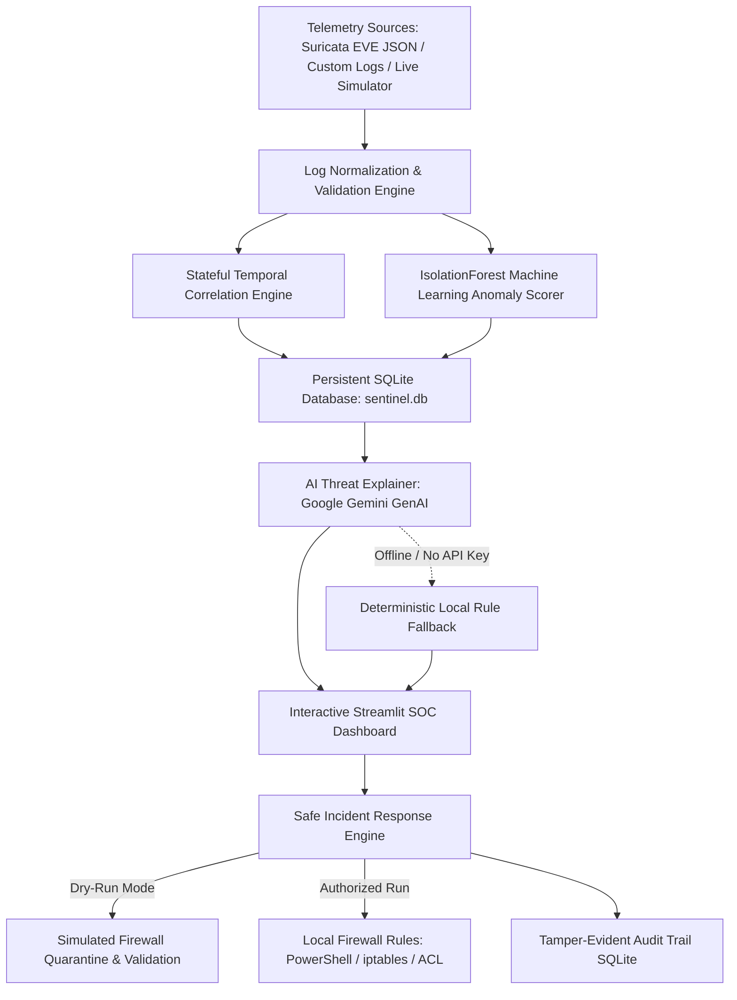

# 🛡️ SentinelAI — AI-Powered Network Intrusion Detection & Incident Response Platform

[](https://www.python.org/)
[](https://streamlit.io/)
[](https://pytest.org/)
[](LICENSE)

SentinelAI is an autonomous, defensive cybersecurity telemetry monitoring, threat detection, and incident response platform. It analyzes network logs and structured security events, correlates multi-event attack behaviors (Port Scans, Brute Force, Volumetric DDoS, and Data Exfiltration), delivers root-cause forensic explanations via **Google Gemini GenAI**, and orchestrates safe, auditable incident containment.

---

## 🏛️ System Architecture



---

## 🚀 Key Features

1. **Multi-Tier Intrusion Detection Engine:**
   - **Stateful Multi-Port Scan Detection (`T1046`):** Identifies distributed port probing across distinct destination ports in configurable time windows.
   - **Brute Force Authentication Tracker (`T1110`):** Correlates repeated connection attempts and credential guessing against administrative ports (`22 SSH`, `3389 RDP`, `445 SMB`, `8080`).
   - **Volumetric DDoS Mitigation (`T1498`):** Flags link-saturating surges exceeding critical capacity thresholds.
   - **Data Exfiltration Detection (`T1048`):** Identifies anomalous bulk outbound transfers directed towards untrusted external IPs.
   - **Optional Machine Learning Anomaly Scorer:** Scikit-Learn `IsolationForest` generates continuous anomaly deviation scores, clearly segregated from rule-based classifications.

2. **Google Gemini GenAI Threat Copilot:**
   - Uses `gemini-2.5-flash` via the official `google-genai` SDK to generate structured root-cause analyses, technical attack mechanisms, potential business impacts, and interactive forensic investigation checklists.
   - **100% Deterministic Local Fallback:** Automatically operates without interruption when offline or if `GEMINI_API_KEY` is not provided.

3. **Safe & Auditable Incident Response:**
   - **Dry-Run by Default:** Formats and validates defensive containment rules without modifying operating system state.
   - **Multi-Platform Firewall Generation:** Generates copyable rules for Windows PowerShell (`New-NetFirewallRule`), Linux `iptables`, Linux `ufw`, and Cisco IOS ACLs.
   - **Reversible Rollbacks:** Automatically provides symmetrical rollback scripts (`Remove-NetFirewallRule`, `iptables -D`).
   - **Command Injection Prevention:** Strict IP address sanitization via Python's standard `ipaddress` library.
   - **Tamper-Evident SQLite Audit Log:** Tracks every status transition, operator action, and containment simulation.

4. **Structured Ingestion & Live Monitoring:**
   - Ingests industry-standard **Suricata EVE JSON** alert/flow logs and generic JSON/CSV logs.
   - Built-in **Live Monitoring Simulator** streaming realistic enterprise traffic with explicitly labeled laboratory scenario injections (`[SIMULATED: Lab Scenario]`).

---

## 💻 Windows Setup & Installation Guide

### Prerequisites
- Windows 10 or 11
- Python 3.12+ installed (ensure **"Add python.exe to PATH"** was checked during Python installation)
- Visual Studio Code or PowerShell terminal

### Step 1: Clone Repository
```powershell
git clone https://github.com/JIYA-R5/CYBERplus.git
cd CYBERplus
```

### Step 2: Create & Activate Virtual Environment
```powershell
# Create virtual environment
python -m venv .venv

# Activate in PowerShell
.\.venv\Scripts\Activate.ps1
```
*(If you encounter an execution policy restriction, run: `Set-ExecutionPolicy -Scope Process -ExecutionPolicy Bypass`)*

### Step 3: Install Required Dependencies
```powershell
pip install -r requirements.txt
```

### Step 4: Configure Environment Variables (Optional)
Copy the template configuration file:
```powershell
Copy-Item .env.example .env
```
Open `.env` in VS Code and set your Google Gemini API key:
```ini
GEMINI_API_KEY=your_actual_gemini_api_key_here
RESPONSE_MODE=dry_run
```
*(Note: If you do not have a Gemini API key, SentinelAI automatically runs in **Deterministic Offline Fallback Mode** with complete offline functionality.)*

---

## 🧪 Running Automated Tests

SentinelAI includes 25 unit and integration tests covering detection rules, temporal correlation, machine learning, AI fallback, log ingestion, and response workflows.

```powershell
pytest -v
```
**Expected Output:**
```text
============================= 25 passed in 3.35s =============================
```

---

## 🖥️ Launching the SentinelAI Dashboard

Run the Streamlit application from PowerShell:
```powershell
streamlit run app.py
```
Your default browser will open automatically to `http://localhost:8501`.

---

## 📁 Repository Directory Structure

```text
CYBERplus/
├── app.py                     # Main multi-tab Streamlit SOC dashboard
├── detector.py                # Stateful detection engine & ML anomaly classifier
├── analyzer.py                # Traffic analytics and DEFCON risk calculator
├── explainerAI.py             # Google Gemini GenAI explainer with offline fallback
├── response_engine.py         # Response engine, IP sanitizer, and rollback generator
├── database.py                # Embedded SQLite persistence (sentinel.db)
├── log_parser.py              # Suricata EVE JSON and generic log parser
├── live_monitor.py            # Thread-safe live telemetry simulator
├── requirements.txt           # Modernized dependency specification
├── .env.example               # Environment configuration template
├── pytest.ini                 # Pytest configuration
├── PROJECT_AUDIT.md           # Stage 1 forensic architectural audit
├── IMPLEMENTATION_PLAN.md     # 9-stage technical roadmap
├── CHANGELOG.md               # Version-controlled modification log
├── DEMO_GUIDE.md              # 5-7 minute presentation script for hackathons
├── data/                      # Test datasets
│   ├── normal_traffic.csv
│   ├── attack_port_scan.json
│   ├── attack_brute_force.json
│   ├── attack_ddos_flood.json
│   ├── suricata_sample.json
│   └── malformed_records.json
└── tests/                     # Automated Pytest suite (25 tests)
    ├── test_detector.py
    ├── test_explainer.py
    ├── test_database.py
    ├── test_ingestion.py
    └── test_response.py
```

---

## 🛡️ Educational & Defensive Compliance Disclaimer
SentinelAI is designed strictly for defensive cybersecurity monitoring, educational research, and authorized laboratory demonstrations. It complies with ethical security practices:
- Live monitoring features clearly label simulated events (`[SIMULATED: Lab Scenario]`).
- The response engine operates in **Dry-Run mode by default** to avoid unexpected network or host disruption.
- AI-generated intelligence briefings are categorized as operational guidance requiring human-in-the-loop analyst validation.
